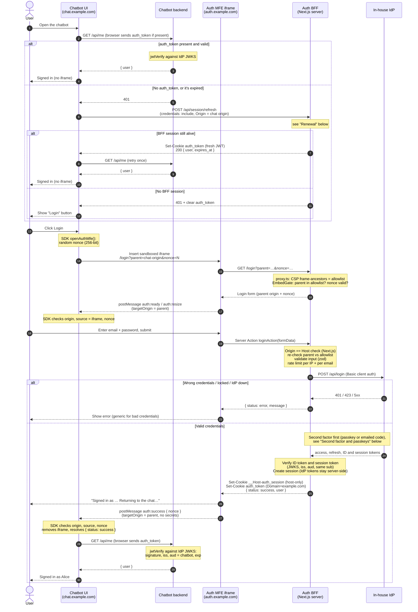
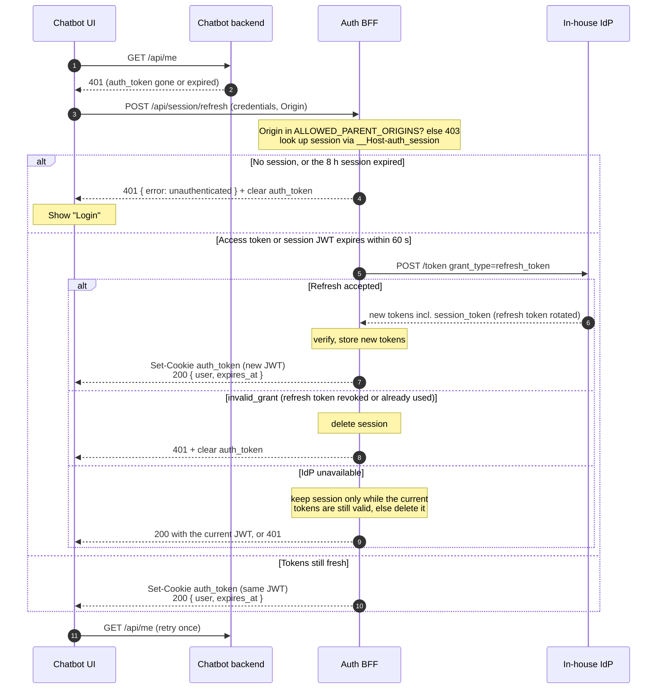
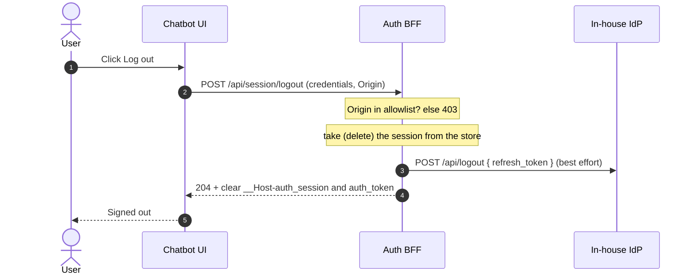
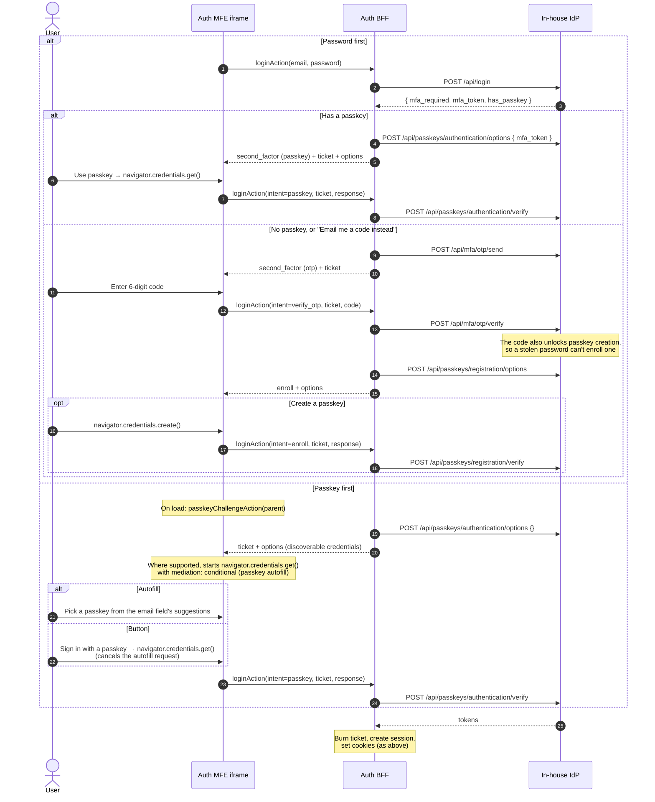

# Auth MFE: end-to-end flow

How a chatbot user signs in through the embedded auth MFE, how the chatbot backend learns who they are, and how the session is renewed and ended.

## Participants

- **Chatbot UI** (`chat.example.com`) embeds the MFE with `openAuthMfe()` from `packages/chatbot-sdk`, and renews or ends the session with `refreshAuthSession()` / `logoutAuthSession()`.
- **Auth MFE iframe** (`auth.example.com`) is `/login` or `/register` from `app/(auth)/`.
- **Auth BFF** is this Next.js app's server side: Server Actions, `proxy.ts` and `/api/session/*`. It is the only party that talks to the IdP and the only holder of IdP access and refresh tokens.
- **Chatbot backend** has no session of its own. It verifies the `auth_token` cookie against the IdP's JWKS on every request. See `examples/chatbot-host/` for a reference implementation.
- **In-house IdP** issues the tokens and publishes the signing keys (JWKS). Locally this is `dev/mock-idp/`.

## Prerequisite: one root domain

The chatbot and the MFE must be served from the same org root domain, set as `SESSION_COOKIE_DOMAIN` (e.g. `example.com`). `getConfig()` refuses to start if `APP_ORIGIN` or any `ALLOWED_PARENT_ORIGINS` entry isn't that domain or one of its subdomains. Because both apps are then same-site, the browser stores and sends `SameSite=Lax` cookies inside the iframe and on the chatbot page's credentialed `fetch` calls to the BFF.

## Cookies

| Cookie | Set by | Attributes | Holds | Read by |
|---|---|---|---|---|
| `__Host-auth_session` | Auth BFF | `auth.example.com` only (`__Host-`: Secure, `Path=/`, no `Domain`), HttpOnly, `SameSite=Lax`, `Max-Age` = `SESSION_TTL_SECONDS` (8 h) | Opaque random session id. The store keeps the session under a hash of it, with the user and all IdP tokens, including the refresh token | Auth BFF (`/api/session/*`) |
| `auth_token` | Auth BFF | `Domain=example.com`, HttpOnly, Secure, `SameSite=Lax`, `Path=/`, `Max-Age` = until the JWT's `exp` | The IdP's **session JWT** | Chatbot backend, plus every other app under the root domain (see Security notes) |

Neither cookie is readable by JavaScript. The chatbot page learns who is signed in only by asking its own backend.

## Session JWT (`auth_token`) contract

The IdP returns `session_token` alongside `access_token`, `id_token` and `refresh_token` in **every** token response: login, second factor, passkey, register and the refresh grant.

| Claim | Value |
|---|---|
| `iss` | The IdP issuer (`IDP_ISSUER`) |
| `aud` | `SESSION_TOKEN_AUDIENCE`, default `chatbot` |
| `sub`, `email`, `name` | The user. `sub` must equal the ID token's `sub` |
| `jti` | Unique per token |
| `iat`, `exp` | Short lifetime: the mock uses 10 minutes |

Header: `alg: RS256`, with the `kid` of a key in the IdP's JWKS.

Who checks what:

- **BFF** (`lib/idp/http-client.ts`): checks the signature against the JWKS, `iss`, `aud`, `exp`, the same `sub` as the ID token, and that `exp` is present. If the token is missing or fails any check, the login or refresh fails as `unavailable`, so a token the BFF wouldn't accept is never set.
- **Chatbot backend**: checks the signature against the IdP's JWKS, with `algorithms: ["RS256"]`, `iss`, `aud`, `exp` and 30 s of clock tolerance.

## Sign-in and page load

`postMessage` now only signals that the cookies are set; it carries no code or token. A forged or replayed `auth:success` gains nothing, because the chatbot still asks its backend, which trusts only a valid JWT.

## Renewal

`auth_token` expires after a few minutes, and the browser then drops it. The BFF session behind it lasts `SESSION_TTL_SECONDS` (8 h, absolute, not sliding).

In the SDK, `refreshAuthSession()` resolves `true` on 200 and `false` on 401, and throws `AuthMfeError("unavailable")` on anything else. The example host calls it once on any 401 from `/api/me`, both on page load and after the iframe reports success.

## Logout

Logout is idempotent: with no session it still clears both cookies and returns 204.

## BFF session API

Both endpoints are called from the chatbot page with `fetch(…, { method: "POST", credentials: "include" })`. They only answer an `Origin` in `ALLOWED_PARENT_ORIGINS`, and reply with `Access-Control-Allow-Origin: <that origin>`, `Access-Control-Allow-Credentials: true`, `Vary: Origin` and `Cache-Control: no-store`. `OPTIONS` preflight is answered for the same origins.

| Endpoint | Success | Failure |
|---|---|---|
| `POST /api/session/refresh` | 200 `{ user: { sub, email, name }, expires_at }` + `Set-Cookie: auth_token` | 401 `{ error: "unauthenticated" }` + clears `auth_token`; 403 `{ error: "forbidden_origin" }` |
| `POST /api/session/logout` | 204, clears both cookies | 403 `{ error: "forbidden_origin" }` |

## Security notes

- **Every subdomain gets `auth_token`.** Any app under the root domain receives it on its requests. The narrow `aud` stops services that check their own audience from accepting it, and the short lifetime limits what a leaked token is worth. Keep untrusted, third-party or user-generated content off the root domain, and watch for dangling DNS records (subdomain takeover).
- **Cookie tossing.** A sibling subdomain can plant an `auth_token`, but it must still be a valid IdP-signed JWT to be accepted. `__Host-auth_session` can't be planted from a subdomain.
- **Logout isn't instant for a token that already leaked.** The JWT stays valid until `exp`. The BFF session and refresh token are revoked immediately, so the token can't be renewed. The same applies to lockouts at the IdP: they take effect at the next refresh.
- **CSRF:** sibling subdomains count as same-site, so `SameSite=Lax` doesn't stop them. `/api/session/*` check `Origin` against the allowlist, Server Actions check `Origin` against `Host`, and the chatbot backend must check `Origin` on its own state-changing routes.
- **Framing:** only `ALLOWED_PARENT_ORIGINS` may frame `/login` and `/register` (CSP `frame-ancestors`). Every other page refuses framing entirely.

## Second factor and passkeys

A password login always needs a second factor. A passkey login needs none, because a passkey with user verification (biometric or PIN) is already two factors. The IdP stores passkeys and verifies every WebAuthn response; the BFF only relays them. The relying party ID is the MFE's host, never the chatbot's.

Steps after the password are tied together by an **MFA ticket** (`lib/mfa-ticket.ts`): random, hashed in the store, 5 minutes, bound to the parent origin, burned when the login completes. The iframe posts it back with each step. It's posted back rather than kept in a cookie, so the login steps don't depend on how a browser treats cookies in iframes.

Constraints to keep in mind:

- **Iframe delegation:** the embedding page must allow WebAuthn in the iframe (`allow="publickey-credentials-get; publickey-credentials-create"`). `openAuthMfe` does this since SDK 0.2.0. Creating passkeys in a cross-origin iframe is newer than using them, so older browsers may refuse. The UI then shows the error, and the user can choose "Not now".
- **User activation:** browsers only run WebAuthn right after a click. Options are fetched before the click (on load, or in the previous step's response), never inside it. Passkey autofill is the exception: it runs without a click.
- **Autofill:** the email field has `autocomplete="username webauthn"`. Saved passwords and saved passkeys then appear in the same suggestion list. Passwords are saved under the MFE's origin, so every chatbot that embeds it shares them.
  - **Passkey suggestions:** `PasskeySignIn` in `app/(auth)/login/passkey-steps.tsx` reuses the passkey-first challenge for a background autofill request. Picking a passkey from the suggestions signs in the same way as the button.
  - **Inside the iframe:** browsers usually wait until the user taps the field before suggesting a saved password. Passkey autofill works in local testing. Support in cross-origin iframes isn't documented across browsers, so "Sign in with a passkey" stays as the entry point that always works.
  - **After a cancelled prompt:** if the user dismisses the button's passkey prompt, passkeys drop out of the suggestions until the next server response brings a fresh challenge.
- **RP ID:** changing it later orphans every passkey. Pick the MFE host or its registrable domain before launch.

## Not shown

- **Cancel:** the Cancel button inside the MFE sends `auth:cancel`. The SDK then removes the iframe and resolves `{ status: "cancelled" }`.
- **Timeout:** if `auth:ready` doesn't arrive within 15 s (the `readyTimeoutMs` option), the SDK throws `AuthMfeError("timeout")`. This is what happens when the chatbot's origin isn't allowed to frame the page.
- **Register:** works the same way as login, through `registerAction` and the IdP's `POST /api/register`. Its rate limit is per IP only. Sign-up doesn't ask for a second factor; the first password login afterwards does, and offers to create a passkey.
