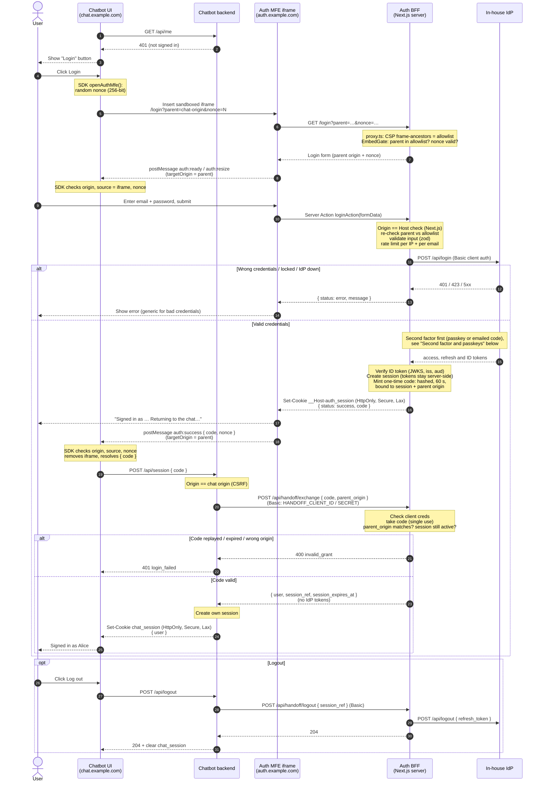
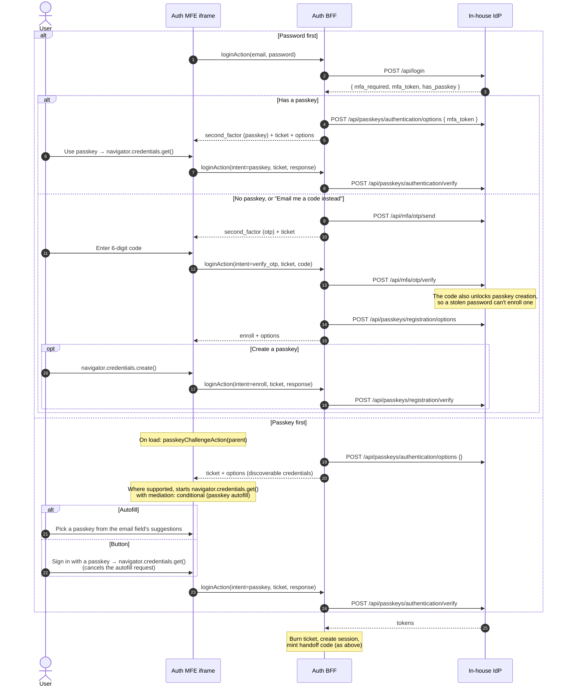

# Auth MFE: end-to-end flow

How a chatbot user signs in through the embedded auth MFE, and how the chatbot ends up with its own session.

- **Chatbot UI** embeds the MFE with `openAuthMfe()` from `packages/chatbot-sdk`.
- **Auth MFE iframe** is `/login` or `/register` from `app/(auth)/`.
- **Auth BFF** is this Next.js app's server side: Server Actions, `proxy.ts` and `/api/handoff/*`.
- **Chatbot backend** redeems the one-time code server-to-server. See `examples/chatbot-host/` for a reference implementation.

## Second factor and passkeys

A password login always needs a second factor. A passkey login needs none, because a passkey with user verification (biometric or PIN) is already two factors. The IdP stores passkeys and verifies every WebAuthn response; the BFF only relays them. The relying party ID is the MFE's host, never the chatbot's.

Steps after the password are tied together by an **MFA ticket** (`lib/mfa-ticket.ts`): random, hashed in the store, 5 minutes, bound to the parent origin, burned when the login completes. The iframe posts it back with each step. It isn't a cookie, because the iframe is cross-site to the chatbot, and browsers don't send `SameSite=Lax` cookies there.

Constraints to keep in mind:

- **Iframe delegation:** the embedding page must allow WebAuthn in the iframe (`allow="publickey-credentials-get; publickey-credentials-create"`). `openAuthMfe` does this since SDK 0.2.0. Creating passkeys in a cross-origin iframe is newer than using them, so older browsers may refuse. The UI then shows the error, and the user can choose "Not now".
- **User activation:** browsers only run WebAuthn right after a click. Options are fetched before the click (on load, or in the previous step's response), never inside it. Passkey autofill is the exception: it runs without a click.
- **Autofill:** the email field has `autocomplete="username webauthn"`. Saved passwords and saved passkeys then appear in the same suggestion list. Passwords are saved under the MFE's origin, so every chatbot that embeds it shares them.
  - **Passkey suggestions:** `PasskeySignIn` in `app/(auth)/login/passkey-steps.tsx` reuses the passkey-first challenge for a background autofill request. Picking a passkey from the suggestions signs in the same way as the button.
  - **Inside the iframe:** browsers usually wait until the user taps the field before suggesting a saved password. Passkey autofill works in local testing. Support in cross-origin iframes isn't documented across browsers, so "Sign in with a passkey" stays as the entry point that always works.
  - **After a cancelled prompt:** if the user dismisses the button's passkey prompt, passkeys drop out of the suggestions until the next server response brings a fresh challenge.
- **RP ID:** changing it later orphans every passkey. Pick the MFE host or its registrable domain before launch.

## Not shown

- **Cancel:** the Cancel button inside the MFE sends `auth:cancel`. The SDK then removes the iframe and resolves `{ status: "cancelled" }`.
- **Timeout:** if `auth:ready` doesn't arrive within 15 s (the `readyTimeoutMs` option), the SDK throws `AuthMfeError("timeout")`. This is what happens when the chatbot's origin isn't allowed to frame the page.
- **Register:** works the same way as login, through `registerAction` and the IdP's `POST /api/register`. Its rate limit is per IP only. Sign-up doesn't ask for a second factor; the first password login afterwards does, and offers to create a passkey.
- **Token refresh:** the auth BFF can refresh an access token that is about to expire through the IdP (`getActiveSession` in `lib/session.ts`). Nothing calls this yet.
