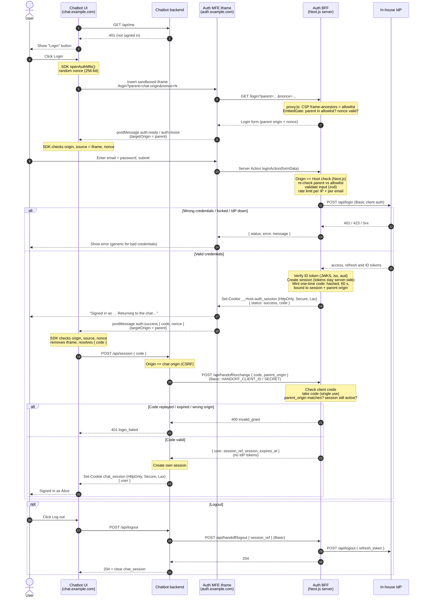

# Auth MFE: end-to-end flow

How a chatbot user signs in through the embedded auth MFE, and how the chatbot ends up with its own session.

- **Chatbot UI** embeds the MFE with `openAuthMfe()` from `packages/chatbot-sdk`.
- **Auth MFE iframe** is `/login` or `/register` from `app/(auth)/`.
- **Auth BFF** is this Next.js app's server side: Server Actions, `proxy.ts` and `/api/handoff/*`.
- **Chatbot backend** redeems the one-time code server-to-server. See `examples/chatbot-host/` for a reference implementation.

## Not shown

- **Cancel:** the Cancel button inside the MFE sends `auth:cancel`. The SDK then removes the iframe and resolves `{ status: "cancelled" }`.
- **Timeout:** if `auth:ready` doesn't arrive within 15 s (the `readyTimeoutMs` option), the SDK throws `AuthMfeError("timeout")`. This is what happens when the chatbot's origin isn't allowed to frame the page.
- **Register:** works the same way as login, through `registerAction` and the IdP's `POST /api/register`. Its rate limit is per IP only.
- **Token refresh:** the auth BFF can refresh an access token that is about to expire through the IdP (`getActiveSession` in `lib/session.ts`). Nothing calls this yet.
